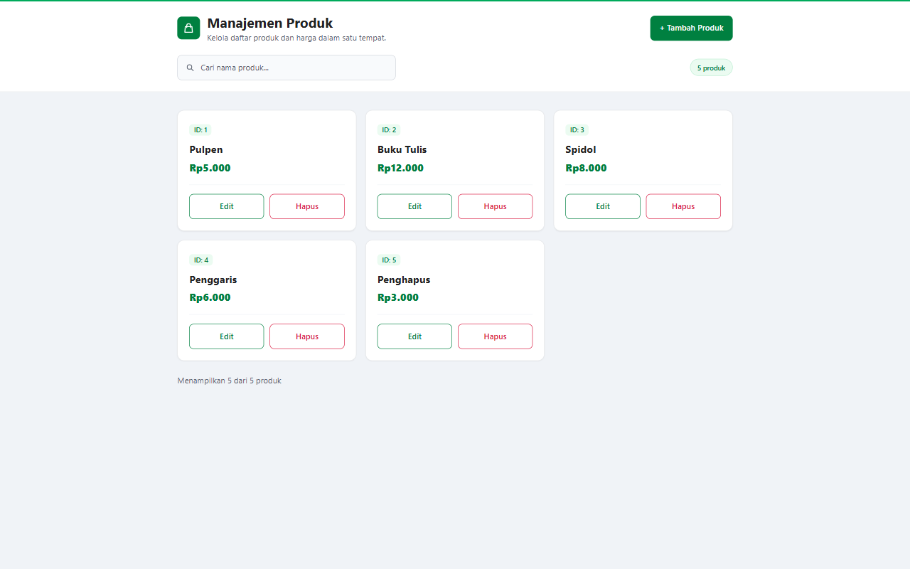
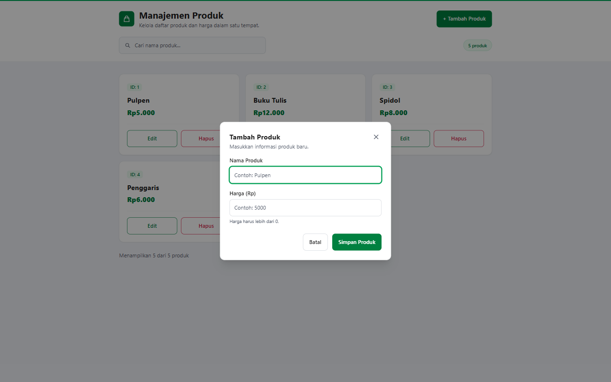
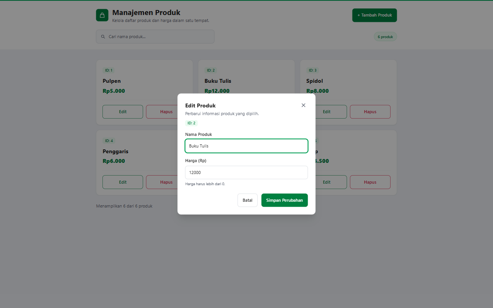
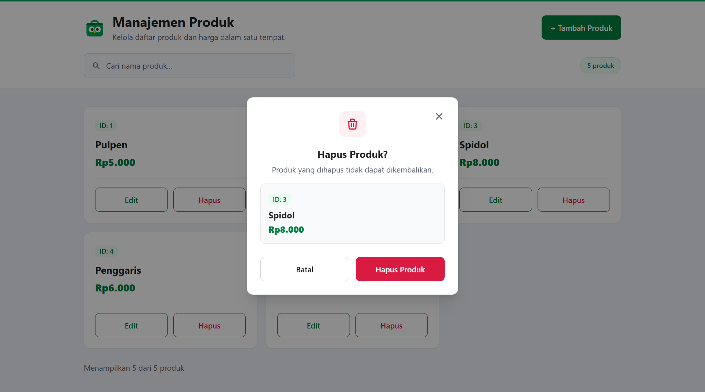
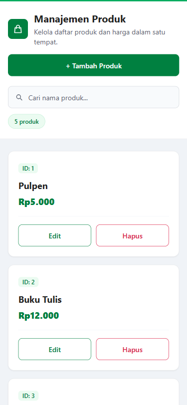

# Manajemen Produk (Tugas 3 Pemrograman Web)

Aplikasi frontend berbasis React 19, Vite, dan Tailwind CSS v4 untuk mengelola daftar produk dan harga. Pengguna dapat melihat katalog kartu produk, menyaring daftar melalui kolom pencarian, menambah produk baru, mengubah data produk, serta menghapus produk lewat dialog konfirmasi.

Proyek ini melanjutkan rangkaian tugas Manajemen Produk pada mata kuliah Pemrograman Web. Tugas 1 membangun REST API Express dengan penyimpanan array di memori, Tugas 2 memindahkan penyimpanan ke PostgreSQL melalui Prisma ORM, dan Tugas 3 membangun antarmuka web React untuk domain katalog produk yang sama. Pada tahap ini, data disimpan pada state React lokal dengan lima produk awal (`Pulpen`, `Buku Tulis`, `Spidol`, `Penggaris`, dan `Penghapus`) agar aplikasi langsung berjalan dengan `npm run dev` tanpa perlu menjalankan server backend atau basis data terpisah.



## Desain UI (Tema Tokopedia)

Antarmuka memakai palet seller Tokopedia yang dipadukan dengan pengecekan kontras WCAG AA:

- Latar halaman memakai abu-abu dingin `#F0F3F7` dengan teks utama `#212121` (rasio kontras 14,47:1) dan kartu putih `#FFFFFF` berbingkai `#E5E7E9` agar setiap kartu terpisah tegas tanpa bayangan berlebih.
- Bagian paling atas header diberi garis hijau `#00AA5B` setebal 3px sebagai penanda identitas tema sekaligus warna indikator fokus keyboard (`focus-visible`), dengan kontras non-teks 3,04:1 terhadap putih.
- Tombol aksi utama (`+ Tambah Produk`), tombol `Edit`, dan teks harga memakai hijau `#008040` (rasio 5,05:1 terhadap putih) alih-alih hijau cerah `#03AC0E` (3,04:1) agar label normal tetap melewati standar kontras minimal 4,5:1.
- Badge nomor `ID` memakai latar `#EBFBF1` dengan teks `#007A3D` (rasio 5,09:1), sedangkan tombol `Hapus`, banner validasi form, dan dialog konfirmasi hapus memakai merah `#D91B42` (rasio 5,02:1 terhadap putih).

## Arsitektur dan Struktur File

State utama berada di komponen `App`, lalu data dan callback aksi diteruskan ke komponen anak melalui props.

| Modul | Lokasi | Peran |
|---|---|---|
| `App` | `src/App.jsx` | Menyimpan state `products`, `nextId` (mulai dari `6`), `searchQuery`, serta kontrol buka-tutup `ProductModal` dan `DeleteModal`. |
| `Navbar` | `src/Navbar.jsx` | Menampilkan header halaman, tombol `+ Tambah Produk`, input pencarian `Cari nama produk...` beserta tombol hapus kata kunci, dan badge jumlah total produk. |
| `ProductCard` | `src/ProductCard.jsx` | Menampilkan satu kartu produk berisi badge `ID`, nama produk, harga terformat, tombol `Edit`, dan tombol `Hapus`. |
| `ProductModal` | `src/ProductModal.jsx` | Satu komponen dialog bersama untuk mode `Tambah Produk` dan `Edit Produk`, memvalidasi input saat submit, serta mendukung penutupan lewat tombol `×`, klik overlay, atau tombol `Escape`. |
| `DeleteModal` | `src/DeleteModal.jsx` | Dialog konfirmasi `Hapus Produk?` berisi pratinjau produk terpilih dan memindahkan fokus awal ke tombol `Batal` untuk mencegah penghapusan tidak sengaja. |
| `formatPrice` | `src/utils/formatPrice.js` | Memformat angka rupiah menjadi string seperti `Rp5.000` menggunakan `Intl.NumberFormat('id-ID')`. |
| `filterProducts`, `validateProductInput` | `src/utils/productUtils.js` | Menyaring produk secara case-insensitive dan memvalidasi agar nama tidak kosong serta harga berupa bilangan bulat lebih dari `0`. |

## Perilaku Fitur dan Kasus Tepi

- Pencarian mencocokkan kata kunci terhadap nama produk secara real-time tanpa membedakan huruf besar atau kecil, disertai penghitung `Menampilkan X dari Y produk` di bagian bawah halaman.
- Jika seluruh produk terhapus atau pencarian tidak menemukan hasil, halaman menampilkan panel status kosong beserta tombol pemulihan (`+ Tambah Produk` atau `Reset Pencarian`).
- Modal tambah dan edit menolak nama kosong, harga kosong, harga `<= 0`, dan angka desimal dengan pesan error pada elemen `role="alert"`.
- Penambahan produk baru menaikkan `nextId` secara berurutan sehingga ID produk yang pernah dihapus tidak digunakan kembali.
- Setiap kontrol interaktif memakai tinggi sentuh minimal 44px agar tetap nyaman ditekan pada layar ponsel maupun dinavigasi dengan keyboard.

## Menjalankan Proyek

Pastikan Node.js sudah terpasang (unit test memakai modul bawaan `node:test` tanpa library test tambahan).

```bash
git clone https://github.com/Afahmisan/Tugas3-Minggu11-Penweb.git
cd Tugas3-Minggu11-Penweb
npm install
npm run dev
```

Perintah pengecekan lokal:

```bash
npm test      # Menjalankan 3 unit test di tests/productUtils.test.js
npm run lint  # Menjalankan oxlint pada seluruh berkas sumber
npm run build # Membangun bundle produksi Vite ke folder dist/
```

Pada PowerShell Windows yang memblokir skrip `npm.ps1`, gunakan `npm.cmd` sebagai pengganti `npm`.

## Pengujian dan Bukti Tampilan

Pengecekan terakhir mencatat 3 dari 3 unit test di `tests/productUtils.test.js` lulus, `oxlint` bersih dengan 0 peringatan dan 0 error, serta `vite build` selesai tanpa kegagalan. Pengujian interaktif pada Chrome untuk viewport desktop (`1280x800`) dan mobile (`375x812`) berjalan tanpa error aplikasi di console dan tanpa horizontal overflow (`375 <= 375`).

| Skenario | Hasil yang Diharapkan | Hasil Aktual |
|---|---|---|
| Halaman awal (`1280x800`) | Lima produk awal tampil lengkap dengan harga terformat dan badge `5 produk` | Sesuai |
| Pencarian dan tombol reset | Kata kunci `"Buku"` menyaring ke `Buku Tulis`; tombol `X` dan `Reset Pencarian` mengembalikan daftar | Sesuai |
| Tambah produk dan validasi | Submit kosong dan harga `0` menampilkan alert; input `"Map"` harga `4500` menambah `ID: 6` | Sesuai |
| Edit produk | Modal terisi data awal `ID: 2` dan memperbarui kartu setelah `Simpan Perubahan` | Sesuai |
| Hapus produk dan tombol `Escape` | `Escape` menutup modal tanpa menghapus; klik `Hapus Produk` menghapus item terpilih | Sesuai |
| Tampilan mobile (`375x812`) | Kartu dan tombol tersusun vertikal tanpa scroll horizontal | Sesuai |

| Modal Tambah Produk | Modal Edit Produk |
|---|---|
|  |  |

| Modal Konfirmasi Hapus | Tampilan Mobile (`375x812`) |
|---|---|
|  |  |
